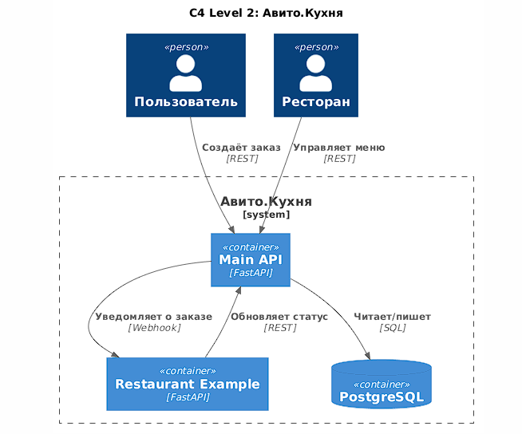
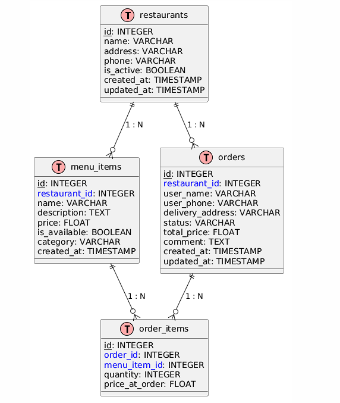
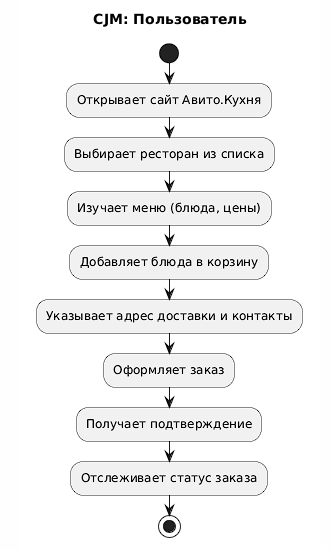
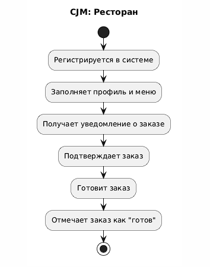

## 🍽️ Авито.Кухня — MVP API для доставки еды

Тестовое задание для стажёра Backend (осенняя волна 2026).

Сервис представляет собой платформу для заказа еды из ресторанов.

---

## 🚀 Быстрый старт

```bash
git clone <репозиторий>
cd avito-kitchen
docker-compose up --build
```

После запуска:
- **Swagger UI:** [http://localhost:8000/api/docs](http://localhost:8000/api/docs)
- **Ресторан-пример:** [http://localhost:8001/health](http://localhost:8001/health)

---

## 📐 Архитектура (C4 Level 2)



### Компоненты

| Компонент | Технология | Описание |
|-----------|------------|----------|
| **Main API** | FastAPI | Центральный сервис: рестораны, меню, заказы |
| **Restaurant Example** | FastAPI | Демо-ресторан, имитирует жизненный цикл заказа |
| **PostgreSQL** | PostgreSQL 15 | Хранит все данные |

### Взаимодействие

1. Пользователь → **Main API** (создание заказа)
2. Ресторан → **Main API** (управление меню)
3. **Main API** → **Restaurant Example** (вебхук о новом заказе)
4. **Restaurant Example** → **Main API** (обновление статуса заказа)

---

## 🗄️ Схема базы данных



### Таблицы

| Таблица | Описание |
|---------|----------|
| `restaurants` | Рестораны (id, name, address, phone, is_active) |
| `menu_items` | Позиции меню (id, restaurant_id, name, price, is_available) |
| `orders` | Заказы (id, restaurant_id, user_name, status, total_price) |
| `order_items` | Товары в заказе (id, order_id, menu_item_id, quantity, price_at_order) |

### Связи

- `restaurants` (1) → `menu_items` (∞)
- `restaurants` (1) → `orders` (∞)
- `orders` (1) → `order_items` (∞)

### Миграции

Управляются через **Alembic**:

```bash
# Применить миграции
alembic upgrade head

# Создать новую миграцию
alembic revision --autogenerate -m "description"
```

---

## 👤 CJM (Customer Journey Map)

### Пользователь



1. Ищет рестораны
2. Выбирает ресторан
3. Смотрит меню
4. Выбирает блюда и количество
5. Указывает адрес доставки и контакты
6. Оформляет заказ
7. Получает подтверждение
8. Отслеживает статус заказа

### Ресторан



1. Получает уведомление о новом заказе
2. Подтверждает заказ
3. Начинает готовить
4. Отмечает заказ готовым

---

## 🔌 API Эндпоинты

| Метод | Путь | Описание |
|-------|------|----------|
| `GET` | `/restaurants` | Список ресторанов |
| `POST` | `/restaurants` | Создать ресторан |
| `GET` | `/restaurants/{id}/menu` | Меню ресторана |
| `POST` | `/restaurants/{id}/menu` | Добавить позицию в меню |
| `POST` | `/orders` | Создать заказ |
| `GET` | `/orders/{id}` | Получить заказ |
| `PATCH` | `/orders/{id}/status` | Обновить статус |

📌 **Полная документация:** [http://localhost:8000/api/docs](http://localhost:8000/api/docs)

---

## 🧪 Тестирование (curl-примеры)

### 1. Создать ресторан

```bash
curl -X POST http://localhost:8000/restaurants \
  -H "Content-Type: application/json" \
  -d '{
    "name": "Моя пиццерия",
    "address": "ул. Пушкина, д. 10",
    "phone": "+7-999-123-45-67"
  }'
```

### 2. Добавить меню

```bash
curl -X POST http://localhost:8000/restaurants/1/menu \
  -H "Content-Type: application/json" \
  -d '{
    "name": "Маргарита",
    "price": 450,
    "description": "Классическая итальянская пицца"
  }'
```

### 3. Создать заказ

```bash
curl -X POST http://localhost:8000/orders \
  -H "Content-Type: application/json" \
  -d '{
    "restaurant_id": 1,
    "user_name": "Иван",
    "user_phone": "+7-999-000-00-00",
    "delivery_address": "ул. Ленина, д. 5",
    "items": [
      {"menu_item_id": 1, "quantity": 2}
    ]
  }'
```

### 4. Статус обновляется автоматически

После создания заказа статус меняется:
`PENDING` → `ACCEPTED` → `PREPARING` → `READY`

---

## 📁 Структура проекта

```
avito-kitchen/
├── src/                    # Основной код
│   ├── main.py            # Точка входа
│   ├── config.py          # Конфигурация
│   ├── database.py        # Подключение к БД
│   ├── models.py          # Модели SQLAlchemy
│   ├── schemas.py         # Pydantic-схемы
│   ├── crud.py            # Операции с БД
│   └── routes/            # Эндпоинты
├── restaurant-example/    # Демо-ресторан
├── migrations/            # Миграции Alembic
├── docs/                  # Диаграммы
├── docker-compose.yml
├── Dockerfile
├── alembic.ini
├── requirements.txt
└── README.md
```

---

## 🛠️ Стек технологий

| Компонент | Технология |
|-----------|------------|
| **Язык** | Python 3.11 |
| **Фреймворк** | FastAPI |
| **ORM** | SQLAlchemy 2.0 |
| **База данных** | PostgreSQL 15 |
| **Миграции** | Alembic |
| **Контейнеризация** | Docker + Docker Compose |
| **Линтеры** | Flake8, Pylint |

---

## 👨‍💻 Автор

**Булат Шарафиев**  
📧 bulatsarafiev721@gmail.com  
[Telegram: @Bulat_789](https://t.me/Bulat_789)
